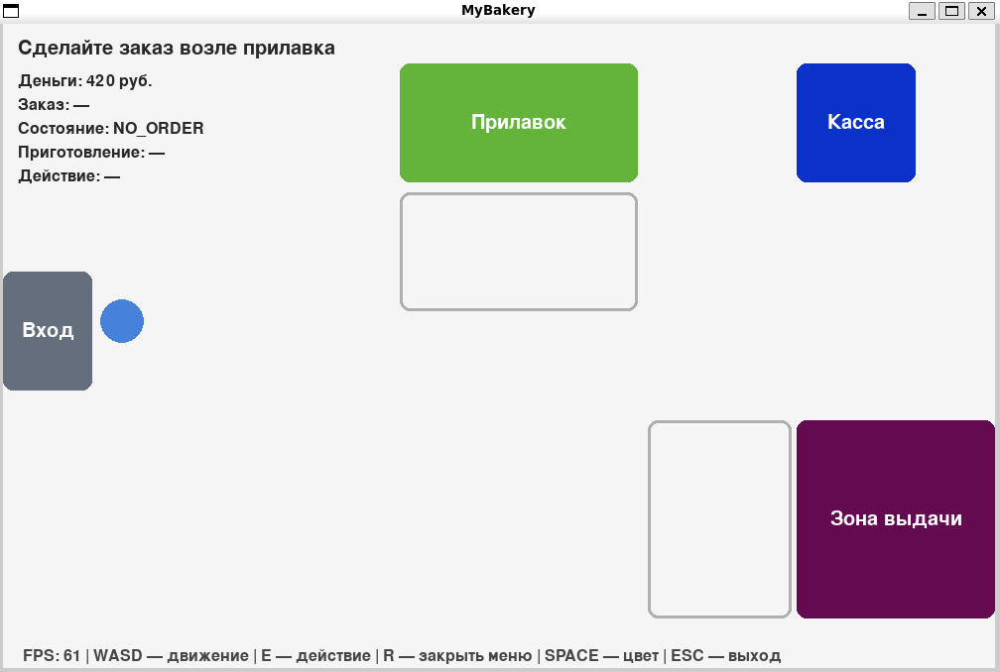
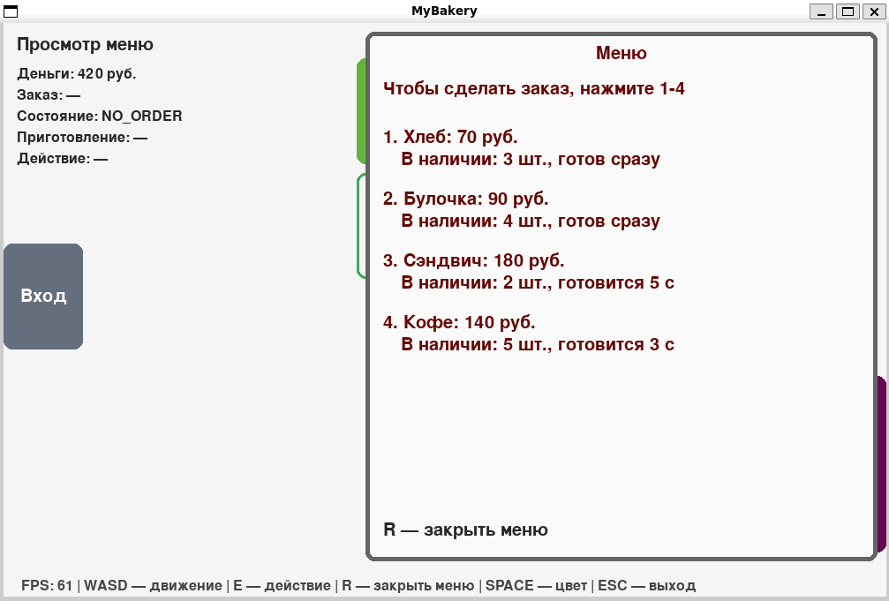

# Симулятор пекарни. Этап 1 — клиент и заказ

Небольшое интерактивное 2D-приложение на **PyGame**. Клиент ходит по пекарне, подходит к прилавку, выбирает товар в меню, ждёт приготовления и получает заказ в зоне выдачи.

## Запуск

```bash
pip install pygame
python main.py
```

## Управление

| Клавиша | Действие |
|---|---|
| `W` `A` `S` `D` | движение клиента |
| `SPACE` | сменить цвет клиента |
| `E` | сделать заказ (у прилавка) / забрать заказ (в зоне выдачи) |
| `1`–`9` | выбрать товар в открытом меню (в зависимости от количества товаров) |
| `R` | закрыть меню без покупки |
| `Esc` | выход |

## Скриншоты

- `screenshots/bakery.png` — общий вид пекарни;
- `screenshots/ordering.png` — меню заказа / процесс приготовления.

## Основные программные решения

### Главный цикл и delta time
Окно 1000 × 650, 60 FPS (`clock.tick(FPS)`). Время кадра `dt` в секундах используется и для движения, и для таймеров. Скорость клиента задана в пикселях в секунду (`SPEED = 260`), поэтому движение не зависит от частоты кадров.

### Структура программы
Цикл в `main()` короткий и состоит из вызовов функций:

```python
handle_events(state, products, zones)   # разовые нажатия клавиш
handle_movement(state, zones, dt)       # непрерывное движение
update_order(state, dt)                 # таймеры и смена состояния заказа
draw_scene(...)                         # сцена
draw_menu(...)                          # меню (если открыто)
draw_ui(...)                            # информационная панель и подсказки
```

Функции `draw_*` только отображают состояние: деньги, остатки и состояние заказа в них не меняются.

### Состояние программы
Всё изменяемое хранится в одном словаре `state` (позиция клиента, деньги, состояние заказа, текущий товар, таймеры, сообщение, признак открытого меню). Функции получают `state` аргументом, поэтому глобальные переменные не нужны. Постоянные значения (размеры окна, скорость, цвета) вынесены в константы.

### Ввод
- Разовые действия (`E`, `R`, `SPACE`, `1`–`9`, `Esc`) обрабатываются через событие `KEYDOWN`: срабатывают один раз на нажатие. Поэтому цвет меняется один раз, а не непрерывно.
- Движение читается через `pygame.key.get_pressed()` и работает при удержании клавиши.
- Направление собирается в `pygame.Vector2` и нормализуется, поэтому по диагонали клиент движется не быстрее, чем по одной оси.
- Пока меню открыто, направление обнуляется и клиент стоит на месте.

### Зоны и столкновения
Зоны сцены заданы `pygame.Rect`: вход, прилавок, касса, зона выдачи и две зоны взаимодействия (перед прилавком и перед выдачей). Прилавок и касса — препятствия. Клиент представлен квадратом `2·радиус`, а его положение ограничено границами окна.

Сдвиг проверяется отдельно по оси X и по оси Y, поэтому клиент скользит вдоль стены, а не «прилипает» к ней.

### Данные о товарах
Товары хранятся в списке словарей (`name`, `price`, `stock`, `cook_time`). Меню рисуется циклом по этому списку, а клавиши `1`–`N` соответствуют индексам. Проверка при заказе идёт в порядке: сначала наличие товара, потом достаточность денег.

### Состояния заказа
Используются состояния `NO_ORDER → WAITING → READY → DONE → NO_ORDER`.

- Хлеб и булочка (время приготовления 0) сразу переходят в `READY`, сэндвич и кофе — в `WAITING`.
- Пока заказ не завершён, оформить новый нельзя, поэтому у клиента один активный заказ.
- В состоянии `DONE` показывается сообщение «Заказ получен», через 2 секунды заказ сбрасывается в `NO_ORDER`, и можно оформить следующий.

### Приготовление без `time.sleep()`
Хранится оставшееся время `cook_left`, которое уменьшается на `dt` каждый кадр в `update_order`. Когда оно доходит до нуля, заказ автоматически переходит в `READY`. Благодаря этому во время готовки клиент продолжает двигаться, окно обновляется и закрывается. Состояние `DONE` завершается таким же отдельным таймером `done_left`.

### Индикатор и информационная панель
Для `WAITING` выводятся название товара, оставшееся время и полоса прогресса (`1 − оставшееся / полное`, ограничено диапазоном 0…1). Когда заказ готов, зона выдачи меняет цвет, а на экране появляется сообщение. Информационная панель постоянно показывает деньги, текущий заказ, состояние, время приготовления, доступное действие и FPS.

## Допущения

- Подсказка `E — сделать заказ` показывается только когда заказ действительно можно оформить (нет активного заказа). Если заказ уже есть, нажатие `E` у прилавка выводит сообщение о том, что заказ ещё готовится или его нужно забрать.
- Вместо символа `₽` используется «руб.», потому что стандартный шрифт PyGame может не отображать этот символ.

## Демонстрация

*Пекарня: доступные действия и информация по заказу*


*Меню: доступные позиции и возможные действия*